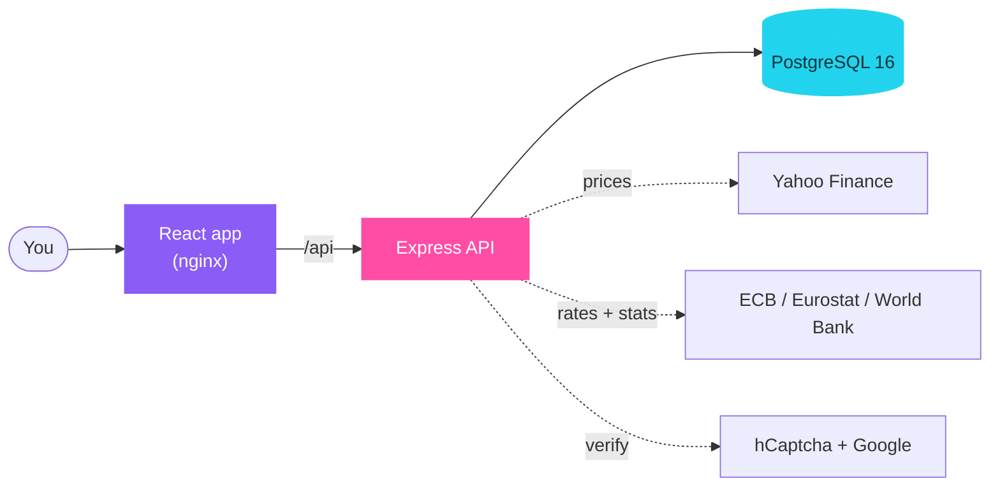
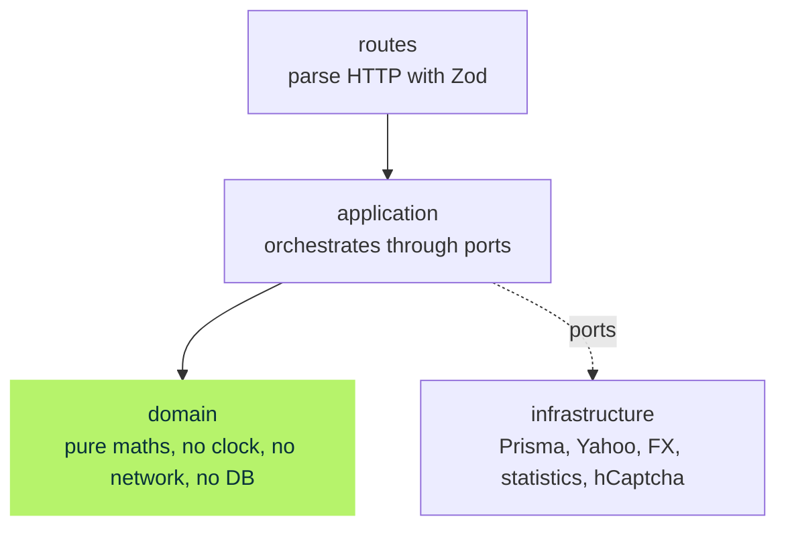
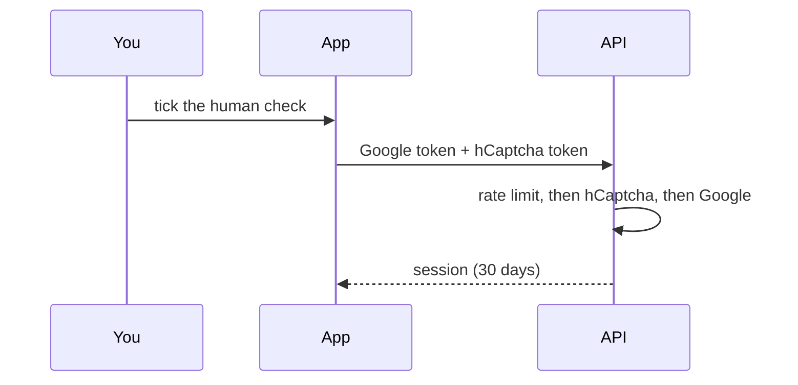

<p align="center"></p>

<p align="center">
  
  
  
  
</p>

> **Your money, your numbers, no noise.** What it is worth, what it has earned, and whether your income can carry the life you want. Built for a handful of people on one small always-on machine, with no hosting bill.
>
> **Sign in with Google, or try the demo in one click.** Passkeys are optional. There are no passwords.

## What you get

| | |
|---|---|
| 📈 **Two honest numbers** | *Total value* and *Total profit*, plus one plain sentence on what drove the profit, before and after inflation. |
| 🧾 **A ledger you can trust** | A buy counts as money you put in, a sale adds to cash, and `value - money put in = profit` always holds. Edit or delete any transaction and the whole ledger is re-checked. |
| 🕰️ **Real history only** | A daily snapshot draws the value line. Nothing is replayed or guessed, so a period shows up only once there is data behind it. |
| 🏠 **Life context** | Homes, income, bills read from PDFs, a "second salary" target, and where you stand against public statistics (Eurostat, World Bank, INDEC). |
| 🌎 **EN + es-AR** | One glossary, enforced by a test. |

## How it fits together



Inside the API the code is hexagonal, and the rule is simple: the closer to the middle, the less it knows about the outside world.



Swapping a vendor or the storage means changing one adapter. Financial maths is written test-first. Schemas live once in `apps/api/src/contracts` and are mirrored to the web (`npm run contracts:check`).

## Security and privacy



- 🤖 **Human check (hCaptcha)** before Google sign-in and the demo, verified on the server. It fails closed and stays off unless both keys are set.
- 🔑 **No passwords.** Google tokens are checked against this app's client id; accounts are found by an HMAC of the email, never the email itself. Passkeys are optional.
- 🔒 **Encrypted profile.** Income, homes, bills and goals are encrypted per field. Transactions and snapshots follow in the next phase.
- 🧪 **Throwaway demo.** Every visitor gets a separate account, erased on sign-out and after an hour.
- 🛡️ **Hardened production.** Non-root read-only containers, a database with no route to the internet, strict CSP, rate-limited sign-in, and age-encrypted daily backups with a tested restore.

## Run it

```bash
cp apps/api/.env.example apps/api/.env      # fill in the values; see the comments
(cd apps/api && npm install && npx prisma generate && npx prisma migrate deploy)
(cd apps/web && npm install)
./dev.sh                                    # Postgres + API :3000 + web :5173
```

Tests are hermetic (no network, no database): `npm test` inside `apps/api` or `apps/web`. `npm run test:integration` in `apps/api` uses a disposable Postgres.

## Deploy

`docker compose --env-file .env.production -f docker-compose.prod.yml up -d --build` runs the whole stack (web on nginx, API, database, one-shot migrations, backups). Designed for a Raspberry Pi 4/5 behind a tunnel such as Tailscale Funnel. Updates are `git pull` and the same command; data stays in its volume.

Everything else (rules, endpoints, vocabulary, decisions) lives in [CLAUDE.md](CLAUDE.md).
